# Platform architecture

This document describes the complete component catalogue, the checked-in
development configuration, and how the modules connect. The diagram shows all
catalogue entries: solid/normal paths are the installed platform; dashed boxes
are optional entries that are disabled in the checked-in configuration. The
resolved environment plan is authoritative for a particular cluster.

## Component and control-plane map

```mermaid
flowchart TB
  subgraph source[Configuration and GitOps]
    flags[components.env plus environment overlays]
    versions[versions.env plus environment overlays]
    catalog[config/platform-catalog.yaml]
    builder[scripts/build-applicationset.py<br/>validates dependencies, policies, and overlays]
    plan[gitops/rendered/&lt;env&gt;/platform-plan.json]
    appset[Argo CD platform ApplicationSet]
    flags --> builder
    versions --> builder
    catalog --> builder
    builder --> plan
    builder --> appset
    appset --> children[Argo CD child Applications<br/>Helm / script / Git adapters]
  end

  subgraph foundation[Cluster foundation]
    cert[cert-manager<br/>CA, wildcard TLS, collector mTLS]
    envoy[Envoy Gateway<br/>Gateway API routes]
    metallb[MetalLB optional<br/>LoadBalancer IP pool]
    eso[External Secrets optional]
    kyverno[Kyverno optional<br/>admission policies]
    olm[OLM<br/>OperatorHub lifecycle]
    children --> cert
    children --> envoy
    children -.-> metallb
    children -.-> eso
    children -.-> kyverno
    children --> olm
  end

  subgraph observability[Observability and storage]
    workloads[Kubernetes workloads<br/>OTLP SDK instrumentation]
    agent[OpenTelemetry agent<br/>DaemonSet, node-local OTLP]
    gateway[OpenTelemetry gateway<br/>StatefulSet, tail sampling, tenant routing]
    alloy[Grafana Alloy<br/>pod logs and annotated-pod metrics]
    prom[Prometheus Operator stack<br/>Prometheus, Grafana, Alertmanager,<br/>kube-state-metrics, node-exporter]
    loki[Loki<br/>logs, 30d normal / 7d content policy]
    tempo[Tempo distributed<br/>traces, agents and agents-content tenants]
    mimir[Mimir distributed<br/>long-term metrics and ruler]
    seaweed[SeaweedFS<br/>S3 API, buckets for Loki/Tempo/Mimir/Velero]
    velero[Velero optional<br/>backup and restore]
    obi[OBI optional<br/>eBPF auto-instrumentation]
    workloads -->|OTLP :4317/:4318| agent
    agent -->|mTLS, sampled trace candidates| gateway
    agent -->|pre-sampling span/service-graph metrics + SDK metrics| mimir
    gateway -->|OTLP traces; agents or agents-content tenant| tempo
    alloy -->|pod logs, tenant agents| loki
    alloy -->|annotated pod metrics| mimir
    prom -->|ServiceMonitor metrics; remote write| mimir
    prom --> grafana[Grafana dashboards and correlations]
    loki --> seaweed
    tempo --> seaweed
    mimir --> seaweed
    velero -.->|backup objects| seaweed
    obi -.->|OTLP to node agent| agent
  end

  subgraph platformapps[Other optional platform modules]
    kcrd[kagent CRDs optional]
    kagent[kagent optional]
    acrd[agentgateway CRDs optional]
    agw[agentgateway optional]
    keda[KEDA]
    vpa[VPA]
    gitlab[GitLab CE optional]
    runner[GitLab Runner optional]
    airflow[Airflow optional]
    rabbit[RabbitMQ]
    kubeflow[Kubeflow optional<br/>Argo CD Git adapter]
    children -.-> kcrd --> kagent
    children -.-> acrd --> agw
    children --> keda
    children --> vpa
    children -.-> gitlab --> runner
    children -.-> airflow
    children --> rabbit
    children -.-> kubeflow
  end

  subgraph exposure[Shared ingress and TLS]
    gatewayapi[Gateway envoy-gateway-system/platform<br/>TLS termination for *.lab.local]
    routes[HTTPRoutes: Argo CD, Grafana, Prometheus,<br/>SeaweedFS S3, Tempo query, RabbitMQ UI]
    cert -->|homelab-ca signs wildcard| gatewayapi
    envoy --> gatewayapi
    gatewayapi --> routes
  end
```

The catalog and flags are the source for enablement and dependency resolution.
The builder fails before cluster mutation for stale output, unknown or disabled
dependencies, cycles, unsupported adapters, invalid overlays, or telemetry
invariant violations. It emits the plan, the ApplicationSet, and reviewable
collector configs. Argo CD owns Helm-backed child applications; OLM uses its
script adapter, and Kubeflow uses its Git/Kustomize adapter.

## Observability signal paths

| Signal | Entry and processing | Destination | Configuration |
|---|---|---|---|
| Application traces | Workload SDK -> node-local `otel-agent`; Kubernetes attributes and redaction; span metrics and service graph derived before sampling; mTLS to gateway; tail sampling and content routing | Tempo distributor; default `agents` tenant (30 days), explicit content `agents-content` tenant (7 days) | [agent](../gitops/apps/26-otel-agent.yaml), [gateway](../gitops/apps/27-otel-gateway.yaml), [Tempo](../gitops/apps/04-tempo.yaml), [policy](../config/telemetry-policy.yaml) |
| SDK metrics | Workload OTLP -> agent | Mimir OTLP endpoint through Mimir gateway | [agent](../gitops/apps/26-otel-agent.yaml), [Mimir](../gitops/apps/28-mimir.yaml) |
| Derived RED and service graph metrics | Agent connectors consume all traces before gateway tail sampling | Mimir | [agent](../gitops/apps/26-otel-agent.yaml) |
| Infrastructure pod logs | Alloy Kubernetes discovery and log tailing | Loki, tenant `agents` | [Alloy](../gitops/apps/05-alloy.yaml), [Loki](../gitops/apps/11-loki.yaml) |
| Annotated pod metrics | Alloy scrapes pods with `prometheus.io/scrape: "true"` | Mimir remote-write endpoint | [Alloy](../gitops/apps/05-alloy.yaml) |
| Cluster/service metrics | Prometheus Operator discovers ServiceMonitors and records locally for six hours; remote-write queue/WAL forwards data | Mimir for long-term queries; short local Prometheus history remains available | [Prometheus stack](../gitops/apps/08-kube-prometheus-stack.yaml) |
| Backup data | Velero object-store plugin | SeaweedFS S3 `velero-backups` bucket | [Velero](../gitops/apps/13-velero.yaml), [secret setup](../scripts/05-velero-secret.sh) |

Grafana provisions Loki, Tempo, and Mimir data sources and links logs to traces,
traces to logs and metrics, and metric exemplars to traces. It uses only the
normal `agents` tenant. The `agents-content` tenant is not exposed as a
Grafana data source in the current OSS setup. Prompt/completion capture defaults
off; the observability-level ConfigMap can enable it only with a TTL, and a
CronJob expires the setting and restarts managed readers.

## Shared ingress and certificates

`cert-manager` bootstraps a self-signed root CA and a `homelab-ca` ClusterIssuer.
That issuer signs the `*.lab.local` wildcard certificate used by the shared
Envoy Gateway and the two collector mTLS certificates in namespace `otel`.
Routes attach to `envoy-gateway-system/platform` and target the owning module's
service. MetalLB is optional; on the configured macOS Docker kind/minikube
driver, the documented tunnel remains the practical host access path.

Route inventory is selected from `config/platform-catalog.yaml` and lives in
[`gitops/platform/routes/`](../gitops/platform/routes/):

| Host | Backend | Enabled by |
|---|---|---|
| `argocd.lab.local` | Argo CD server | Always |
| `grafana.lab.local` | Grafana | kube-prometheus-stack |
| `prometheus.lab.local` | Prometheus | kube-prometheus-stack |
| `seaweedfs.lab.local` | SeaweedFS S3 API | SeaweedFS |
| `tempo.lab.local` | Tempo query frontend | Tempo |
| `rabbitmq.lab.local` | RabbitMQ management UI | RabbitMQ |

## Complete component catalogue

Status reflects the checked-in root `components.env` on 2026-10-15. Environment
files can override these flags; inspect that environment's `platform-plan.json`
for its resolved state. Optional means the module is part of the platform but
is currently disabled.

| Module | Status | Adapter / role | Owning configuration |
|---|---|---|---|
| `cert-manager` | Enabled | Helm; CA and certificate lifecycle | [01-cert-manager](../gitops/apps/01-cert-manager.yaml), [issuers](../gitops/platform/cluster-issuers.yaml) |
| `metallb` | Optional | Helm; LoadBalancer IP allocation | [02-metallb](../gitops/apps/02-metallb.yaml), `scripts/07-metallb-config.sh` |
| `external-secrets` | Optional | Helm; external secret synchronization | [03-external-secrets](../gitops/apps/03-external-secrets.yaml) |
| `kyverno` | Optional | Helm; admission policy engine | [20-kyverno](../gitops/apps/20-kyverno.yaml), [AI workload policies](../gitops/policies/ai-workload-policies.yaml) |
| `envoy-gateway` | Enabled | Helm; Gateway API ingress | [06-envoy-gateway](../gitops/apps/06-envoy-gateway.yaml), [Gateway](../gitops/platform/gateway.yaml) |
| `kube-prometheus-stack` | Enabled | Helm; Prometheus, Grafana, Alertmanager and exporters | [08-kube-prometheus-stack](../gitops/apps/08-kube-prometheus-stack.yaml) |
| `tempo` | Enabled | Helm; distributed trace backend, S3 on SeaweedFS | [04-tempo](../gitops/apps/04-tempo.yaml) |
| `alloy` | Enabled | Helm; logs and annotated pod metrics collection | [05-alloy](../gitops/apps/05-alloy.yaml) |
| `loki` | Enabled | Helm; log backend, S3 on SeaweedFS | [11-loki](../gitops/apps/11-loki.yaml) |
| `mimir` | Enabled | Helm; long-term metrics and ruler, S3 on SeaweedFS | [28-mimir](../gitops/apps/28-mimir.yaml), [AI governance rules](../gitops/platform/ai-governance-rules.yaml) |
| `seaweedfs` | Enabled | Helm; S3-compatible object storage | [12-seaweedfs](../gitops/apps/12-seaweedfs.yaml) |
| `velero` | Optional | Helm; cluster backup/restore, SeaweedFS target | [13-velero](../gitops/apps/13-velero.yaml), [credential setup](../scripts/05-velero-secret.sh) |
| `kagent-crds` | Optional | Helm; CRD installation for kagent | [14-kagent-crds](../gitops/apps/14-kagent-crds.yaml) |
| `kagent` | Optional | Helm; Kubernetes AI agent framework | [15-kagent](../gitops/apps/15-kagent.yaml) |
| `agentgateway-crds` | Optional | Helm; CRD installation for agentgateway | [17-agentgateway-crds](../gitops/apps/17-agentgateway-crds.yaml) |
| `agentgateway` | Optional | Helm; agent and MCP traffic gateway | [18-agentgateway](../gitops/apps/18-agentgateway.yaml) |
| `keda` | Enabled | Helm; event-driven workload scaling | [19-keda](../gitops/apps/19-keda.yaml) |
| `vpa` | Enabled | Helm; vertical pod resource recommendations/updates | [21-vpa](../gitops/apps/21-vpa.yaml) |
| `gitlab` | Optional | Helm; source control, CI and registry | [22-gitlab](../gitops/apps/22-gitlab.yaml) |
| `gitlab-runner` | Optional | Helm; CI job execution; depends on GitLab | [23-gitlab-runner](../gitops/apps/23-gitlab-runner.yaml) |
| `airflow` | Optional | Helm; workflow orchestration | [24-airflow](../gitops/apps/24-airflow.yaml) |
| `rabbitmq` | Enabled | Helm; message broker and Prometheus metrics | [25-rabbitmq](../gitops/apps/25-rabbitmq.yaml) |
| `otel-gateway` | Enabled | Helm; StatefulSet collector tier, mTLS receiver, tail sampling and trace tenant routing | [27-otel-gateway](../gitops/apps/27-otel-gateway.yaml), [mTLS certs](../gitops/platform/otel-mtls.yaml) |
| `otel-agent` | Enabled | Helm; node DaemonSet, enrichment, redaction, derived metrics and reliable export | [26-otel-agent](../gitops/apps/26-otel-agent.yaml) |
| `obi` | Enabled in dev/staging; disabled in prod | Helm; eBPF zero-code instrumentation, exports to node agent | [29-obi](../gitops/apps/29-obi.yaml) |
| `olm` | Enabled | Script; Operator Lifecycle Manager from official manifests | [`scripts/06-olm.sh`](../scripts/06-olm.sh) |
| `kubeflow` | Optional | Argo CD Git adapter; Kustomize-based ML platform | [special manifest](../gitops/special/16-kubeflow.yaml) |

The checked-in dev plan currently enables 15 catalogue entries: cert-manager,
Envoy Gateway, kube-prometheus-stack, SeaweedFS, Tempo, Loki, Mimir, Alloy,
KEDA, VPA, RabbitMQ, both OpenTelemetry collector tiers, OBI, and OLM. Staging
also enables OBI; prod leaves it disabled pending a security review. Components
such as Velero, MetalLB, Kubeflow, GitLab, and the agent tools are deliberately
not installed merely because their manifests are present.

## Configuration and operational entry points

- [Catalogue](../config/platform-catalog.yaml): flags, adapters, manifests,
  dependencies and route selection.
- [Base flags](../components.env), [base versions](../versions.env): defaults
  for the platform. `environments/<name>/` supplies targeted overrides.
- [Environment guide](../environments/README.md): supported overlays and
  rendering workflow.
- [Rendered dev plan](../gitops/rendered/dev/platform-plan.json): resolved
  enablement, dependency provenance, versions, namespaces and routes for dev.
- `make render ENV=dev` regenerates the checked-in application plan; inspect
  its diff before `make apply ENV=dev` changes the cluster.
- `bash scripts/build-applicationset.sh --check` checks that generated output
  matches current sources without applying cluster changes.
- [Observability level controls](../gitops/platform/observability-levels.yaml)
  configure verbosity and time-limited content capture.
- [Telemetry policy](../config/telemetry-policy.yaml) and
  [GenAI instrumentation contract](genai-instrumentation.md) describe the
  collector invariants and workload instrumentation contract.

For application instrumentation, send OTLP to
`http://otel-agent-opentelemetry-collector.otel.svc:4317`. The agent Service
uses `internalTrafficPolicy: Local`, ensuring Kubernetes metadata enrichment
runs on the node that received the workload connection. Collector secrets are
issued from cert-manager by `scripts/04-apply-apps.sh` before health waits, so
both tiers can mount their TLS volumes during startup.
